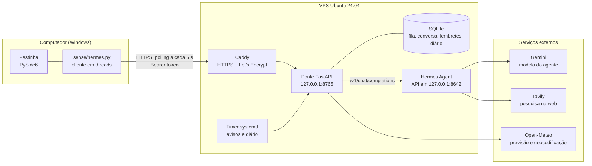

# Pestinha + Hermes

Um pet de tela que ganhou um cérebro na nuvem. Baseado no [Pestinha](https://github.com/mille-okws/pestinha),
criado por [mille-okws](https://github.com/mille-okws).

O **Pestinha** é um pet de desktop (Python + Qt) que vive no monitor, reage ao que acontece no computador e
aprende com uma rede neural própria. Este projeto liga o pet a um **agente de IA**, o
[Hermes Agent](https://hermes-agent.nousresearch.com/), rodando numa VPS. O pet passa a receber falas do
agente como post-its, conversa com você e reage com o corpo ao que acontece, de dentro de uma rede
corporativa e sem VPN.


## O que ele faz

- **Conversa.** Clique duplo no pet (ou Ctrl+Alt+P) abre um balão para escrever; clique duplo num post-it dele
  responde àquela fala. Ele lembra as últimas mensagens por 30 minutos, então dá para continuar o assunto.
- **Dois cérebros.** A rede neural local continua decidindo o que o pet sente; o agente conversa e pode pedir
  coisas ao corpo (dormir, brincar, aprontar, trabalhar junto). Quem decide se obedece é o instinto: bravo, ele
  recusa revirando os olhos. O agente também recebe o humor do pet e fala no tom certo.
- **Lado de fora.** Na cidade que você escolher, ele dá bom-dia com a previsão, avisa se vai chover na volta
  para casa, comemora sexta-feira e véspera de feriado (feriados nacionais calculados, inclusive os móveis).
- **Lembretes.** "Me lembra daqui a 30 min de ligar para o cliente": na hora ele acorda, toca um despertador
  e mostra o post-it. Dá para listar, cancelar e adiar conversando.
- **Diário.** O pet conta só números (minutos em cada emoção, cutucadas, castigos, travessuras) e, às 21h, o
  agente escreve a página do dia no jeito dele. Sempre que anota algo, o pet tira um caderninho e rabisca.
- **Pesquisa na internet.** Para coisas atuais (notícias, resultados, preços), o agente pesquisa e resume no post-it.
- **Animações.** Nuvem de pensamento estilo HQ enquanto o agente pensa, "!" quando chega fala, post-its que
  saem voando de trás dele, guarda-chuva, óculos escuros, cachecol, chapéu de festa e confete conforme o tempo
  e o calendário, estrela quando obedece, bufo quando é contrariado.
- **Visitas.** Os pets de pessoas diferentes se visitam: o seu sai de casa, aparece na tela da outra pessoa,
  cumprimenta, brinca um minuto e volta contando como foi.
- **Post-its como janelas.** Arrastam pela barra de cima e fecham no ×. Um clique numa travessura também fecha,
  mas deixa o pet bravo; o × fecha numa boa.

## Arquitetura



| Peça | Onde | Papel |
|---|---|---|
| [`pestinha/sense/hermes.py`](pestinha/sense/hermes.py) | PC | Consulta a fila e envia perguntas em threads próprias; o Qt só recolhe o resultado. |
| [`pestinha/controle/vivo.py`](pestinha/controle/vivo.py) | PC | As reações do corpo à conversa (pensando, "!", tempo, lembrete, obedecer e recusar). |
| [`pestinha/body/figurino.py`](pestinha/body/figurino.py), [`pestinha/world/palco.py`](pestinha/world/palco.py) | PC | O que ele veste (desenhado no pet) e o que flutua em volta (janela transparente que segue o pet). |
| [`ponte/`](ponte/README.md) | VPS | Fila de eventos, autenticação, persona, memória curta, lembretes, clima, calendário e diário. |
| [`deploy/`](deploy/) | VPS | Serviços e timer systemd de usuário, Caddyfile e modelo de configuração. |
| Hermes Agent | VPS | O agente, com o Gemini como modelo; na API do pet, só com pesquisa na web e memória. |

## Decisões técnicas

**Polling HTTP em vez de WebSocket.** O pet roda num computador de trabalho, atrás do firewall e do proxy da
empresa. Uma requisição HTTPS de saída a cada 5 segundos passa em praticamente qualquer rede, não precisa de
VPN nem de porta aberta no PC, e é trivial de depurar com `curl`. A latência de poucos segundos é irrelevante
para um post-it.

**Uma ponte entre o pet e o agente.** O Hermes nunca fica exposto na internet: a API dele escuta só em
`127.0.0.1`. A ponte expõe só rotas pequenas, valida o token, limita o tamanho das perguntas e define a
persona. Se um dia o agente mudar, só a ponte muda.

**Agente com o mínimo de ferramentas.** Na API usada pelo pet, o Hermes tem só pesquisa na web e memória:
nada de terminal, arquivos ou execução de código. Testado pedindo para ele ler um arquivo da VPS (ele não
consegue). Lembretes, clima e diário são código da ponte, não ferramentas do agente.

**Fila com id crescente, gravada em SQLite.** O pet pergunta "o que veio depois do id N?" e guarda o último
id que mostrou. Nada se perde se o pet ficar fechado ou se a ponte reiniciar, e nada aparece duas vezes. Na
primeira conexão, o histórico antigo não é despejado na tela.

**A rede nunca trava a interface.** Toda chamada HTTP roda fora da thread do Qt. Com a VPS fora do ar, o
cliente dobra a espera entre tentativas até 60 segundos e o pet segue normal.

**Custo sob controle.** Uma chamada ao agente custa milhares de tokens (instruções e ferramentas internas).
Por isso o polling nunca chama o Hermes: ele só é acionado quando você pergunta algo ou um agendamento manda.
A previsão do tempo fica em cache por 30 minutos, e os feriados são calculados localmente.

**O agente pede, o instinto decide.** O Hermes pede ações ao corpo com uma marca `[acao: nome]`, mas o pet
obedece ou recusa conforme a emoção e a energia do momento. A IA nova não passa por cima da rede neural do
projeto original.

**Animação com curvas, não quadros.** Tudo é desenhado com QPainter e curvas de movimento (elástico, quique,
balanço, Bézier), sem imagens prontas. O que flutua em volta do pet fica numa janela transparente que deixa
o clique passar, para nunca atrapalhar o uso do computador.

**O modelo entende, o código calcula.** Nos lembretes, o agente só traduz o pedido ("daqui a 30 min") numa
marca `[lembrete: +30 | ...]`; a hora exata, o armazenamento e o disparo são da ponte. O modelo erra conta
de horário e às vezes promete o que não fez: se disser "te lembro" sem marcar, a ponte troca a resposta.

**Segurança da VPS.** Login só por chave SSH, root e senha desligados, firewall liberando apenas 22, 80 e 443,
deploy key do GitHub só de leitura, segredos em arquivos `chmod 600` fora do repositório, comparação do token
em tempo constante e a rota `/interno` bloqueada no Caddy e na própria aplicação.

## Problemas reais resolvidos no caminho

- **O PowerShell 5.1 grava UTF-8 com BOM.** O `Set-Content -Encoding utf8` acrescenta `EF BB BF` no começo do
  arquivo, o leitor de JSON recusava e o recurso desligava sem aviso. Correção: leitura com `utf-8-sig` e
  mensagem no log quando o arquivo existe mas não serve.
- **"Funciona na VPS, mas não no PC".** O certificado saiu e a VPS respondia, mas o PC não resolvia o nome.
  Comparar o DNS da rede com o `8.8.8.8` mostrou que o servidor DNS corporativo tinha guardado o "não existe"
  de um teste anterior à criação do registro; o tempo de cache negativo veio do SOA do domínio (30 min).
- **Serviço que morria ao sair do SSH.** O instalador do agente cria um serviço systemd *de usuário*, que
  para quando a sessão fecha. `loginctl enable-linger` resolve.
- **O pet prometia lembrar e não lembrava.** Pedido de lembrete, o modelo respondia "claro, te lembro!" sem
  ter como agendar nada. Agora a ponte só confirma o que guardou de fato e, se o modelo prometer sem marcar,
  troca a resposta por um "não entendi para quando".
- **Teste que só falhava no Windows.** O relógio do Windows anda de ~15 em 15 ms: encerrar a nuvem de
  pensamento e conferir logo depois caía no mesmo instante, e ela ainda contava como ativa. O CI no Windows
  pegou; a regra passou a valer no próprio instante do encerramento.
- **Pet tremendo à toa.** Fechar uma travessura contava como rejeição, que virava raiva e tremedeira. Agora há
  dois jeitos: o × fecha numa boa (ele só aprende a esperar) e o clique fecha com raiva, para quem quiser.
- **Primeira emissão de certificado falhando.** O Caddy pediu o certificado antes de o DNS propagar
  (`NXDOMAIN`) e conseguiu sozinho na nova tentativa, dois minutos depois.

## Tecnologias

Python 3.11+, PySide6 (Qt), FastAPI, Uvicorn, httpx, SQLite, pytest, GitHub Actions, PyInstaller, Inno Setup,
Ubuntu 24.04, systemd, UFW, OpenSSH, Caddy, Let's Encrypt, Cloudflare DNS, Hermes Agent, Gemini, Tavily e
Open-Meteo.

## Rodando

- **Pet:** veja [docs/PESTINHA.md](docs/PESTINHA.md) (instalação, interação, privacidade e como gerar o executável).
- **Ligar o pet ao Hermes:** [docs/HERMES.md](docs/HERMES.md).
- **Ponte na VPS:** [ponte/README.md](ponte/README.md).
- **Outra pessoa com o próprio pet, Hermes e personalidade, na mesma VPS:** [docs/OUTRA-PESSOA.md](docs/OUTRA-PESSOA.md).

## Testes

```bash
python -m pytest -q                      # pet: 500+ testes, Qt em modo offscreen
cd ponte && python -m pytest -q          # ponte
```

O CI roda os dois conjuntos separadamente (o do pet no Windows, como o executável), cada um só quando a sua
parte muda.

## Próximos passos

- Diário de projetos: o pet anota o que você construiu na semana e o agente rascunha um post.
- O pet contando ao agente o tipo de atividade em uso (só a categoria, nunca o conteúdo) para comentários com contexto.
- Eventos de humor mudando a emoção do pet (o canal já existe, ainda sem efeito).

## Créditos e licença

O **Pestinha** foi criado por [**mille-okws**](https://github.com/mille-okws): o pet, a rede neural, os
personagens e todo o comportamento vêm do [projeto original](https://github.com/mille-okws/pestinha).
Este repositório parte dele e acrescenta a integração com o Hermes: a ponte, o cliente no pet, os dois
cérebros, a conversa, os avisos do lado de fora, os lembretes, o diário, as animações novas e o deploy na VPS.

Código sob a [GNU General Public License v3.0 ou posterior](LICENSE). As imagens e os textos de `assets/`
não estão cobertos por esta licença; veja [assets/LEIA-ME.txt](assets/LEIA-ME.txt).
