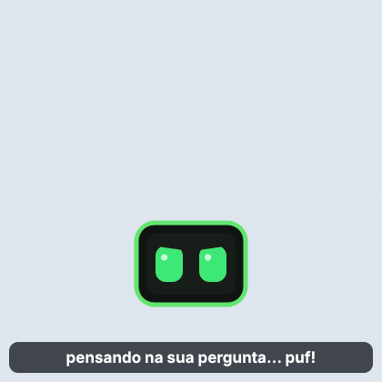
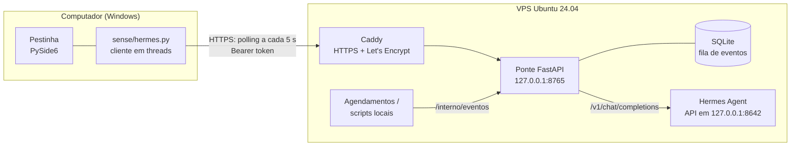

# Pestinha + Hermes

Um pet de tela que ganhou um cérebro na nuvem. Baseado no [Pestinha](https://github.com/mille-okws/pestinha),
criado por [mille-okws](https://github.com/mille-okws).

O **Pestinha** é um pet de desktop (Python + Qt) que vive no monitor, reage ao que acontece no computador e
aprende com uma rede neural própria. Este projeto liga o pet a um **agente de IA**, o
[Hermes Agent](https://hermes-agent.nousresearch.com/), rodando numa VPS. O pet passa a receber falas do
agente como post-its e dá para conversar com ele pelo menu, de dentro de uma rede corporativa e sem VPN.



<!--
Demonstração: grave um GIF curto (ScreenToGif, por exemplo) do post-it aparecendo, salve em
docs/imagens/hermes_demo.gif e tire esta linha de dentro do comentário:

-->

## Arquitetura



| Peça | Onde | Papel |
|---|---|---|
| [`pestinha/sense/hermes.py`](pestinha/sense/hermes.py) | PC | Consulta a fila e envia perguntas em threads próprias; o Qt só recolhe o resultado. |
| [`ponte/`](ponte/README.md) | VPS | Fila de eventos, autenticação e repasse das perguntas ao Hermes. |
| [`deploy/`](deploy/) | VPS | Serviço systemd de usuário, Caddyfile e modelo de configuração. |
| Hermes Agent | VPS | O agente: modelo de linguagem, ferramentas e agendador. |

## Decisões técnicas

**Polling HTTP em vez de WebSocket.** O pet roda num computador de trabalho, atrás do firewall e do proxy da
empresa. Uma requisição HTTPS de saída a cada 5 segundos passa em praticamente qualquer rede, não precisa de
VPN nem de porta aberta no PC, e é trivial de depurar com `curl`. A latência de poucos segundos é irrelevante
para um post-it.

**Uma ponte entre o pet e o agente.** O Hermes nunca fica exposto na internet: a API dele escuta só em
`127.0.0.1`. A ponte expõe apenas três rotas pequenas, valida o token, limita o tamanho das perguntas e
define a persona. Se um dia o agente mudar, só a ponte muda.

**Fila com id crescente, gravada em SQLite.** O pet pergunta "o que veio depois do id N?" e guarda o último
id que mostrou. Nada se perde se o pet ficar fechado ou se a ponte reiniciar, e nada aparece duas vezes. Na
primeira conexão, o histórico antigo não é despejado na tela.

**A rede nunca trava a interface.** Toda chamada HTTP roda fora da thread do Qt. Com a VPS fora do ar, o
cliente dobra a espera entre tentativas até 60 segundos e o pet segue normal.

**Custo sob controle.** Uma chamada ao agente custa milhares de tokens (instruções e ferramentas internas).
Por isso o polling nunca chama o Hermes: ele só é acionado quando você pergunta algo ou um agendamento manda.

**Segurança da VPS.** Login só por chave SSH, root e senha desligados, firewall liberando apenas 22, 80 e 443,
deploy key do GitHub só de leitura, segredos em arquivos `chmod 600` fora do repositório, comparação do token
em tempo constante e a rota `/interno` bloqueada no Caddy e na própria aplicação.

## Problemas reais resolvidos no caminho

- **O PowerShell 5.1 grava UTF-8 com BOM.** O `Set-Content -Encoding utf8` acrescenta `EF BB BF` no começo do
  arquivo, o leitor de JSON recusava e o recurso desligava sem aviso. Correção: leitura com `utf-8-sig` e
  mensagem no log quando o arquivo existe mas não serve.
- **"Funciona na VPS, mas não no PC".** O certificado saiu e a VPS respondia, mas o PC não resolvia o nome.
  Comparar o DNS da rede com o `8.8.8.8` mostrou que o servidor DNS corporativo tinha guardado o "não existe"
  de um teste anterior à criação do registro; o tempo de cache negativo veio do SOA do domínio (30 min).
- **Serviço que morria ao sair do SSH.** O instalador do agente cria um serviço systemd *de usuário*, que
  para quando a sessão fecha. `loginctl enable-linger` resolve.
- **Primeira emissão de certificado falhando.** O Caddy pediu o certificado antes de o DNS propagar
  (`NXDOMAIN`) e conseguiu sozinho na nova tentativa, dois minutos depois.

## Tecnologias

Python 3.11+, PySide6 (Qt), FastAPI, Uvicorn, httpx, SQLite, pytest, GitHub Actions, PyInstaller, Inno Setup,
Ubuntu 24.04, systemd, UFW, OpenSSH, Caddy, Let's Encrypt, Cloudflare DNS e Hermes Agent.

## Rodando

- **Pet:** veja [docs/PESTINHA.md](docs/PESTINHA.md) (instalação, interação, privacidade e como gerar o executável).
- **Ligar o pet ao Hermes:** [docs/HERMES.md](docs/HERMES.md).
- **Ponte na VPS:** [ponte/README.md](ponte/README.md).

## Testes

```bash
python -m pytest -q                      # pet: 400+ testes, Qt em modo offscreen
cd ponte && python -m pytest -q          # ponte
```

O CI roda os dois conjuntos separadamente, cada um só quando a sua parte muda.

## Próximos passos

- Lembretes em linguagem natural ("me lembra às 16h de…"), agendados pelo próprio agente.
- Diário de projetos: o pet anota o que você construiu na semana e o agente rascunha um post.
- O pet contando ao agente o tipo de atividade em uso (só a categoria, nunca o conteúdo) para comentários com contexto.
- Eventos de humor mudando a emoção do pet.

## Créditos e licença

O **Pestinha** foi criado por [**mille-okws**](https://github.com/mille-okws): o pet, a rede neural, os
personagens e todo o comportamento vêm do [projeto original](https://github.com/mille-okws/pestinha).
Este repositório parte dele e acrescenta a integração com o Hermes: a ponte, o cliente no pet, os dois
cérebros, os avisos do lado de fora e o deploy na VPS.

Código sob a [GNU General Public License v3.0 ou posterior](LICENSE). As imagens e os textos de `assets/`
não estão cobertos por esta licença; veja [assets/LEIA-ME.txt](assets/LEIA-ME.txt).
